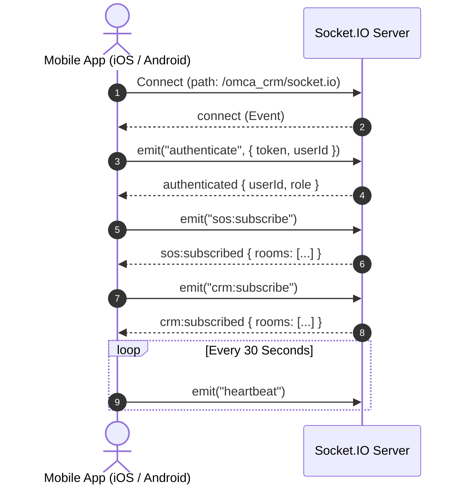
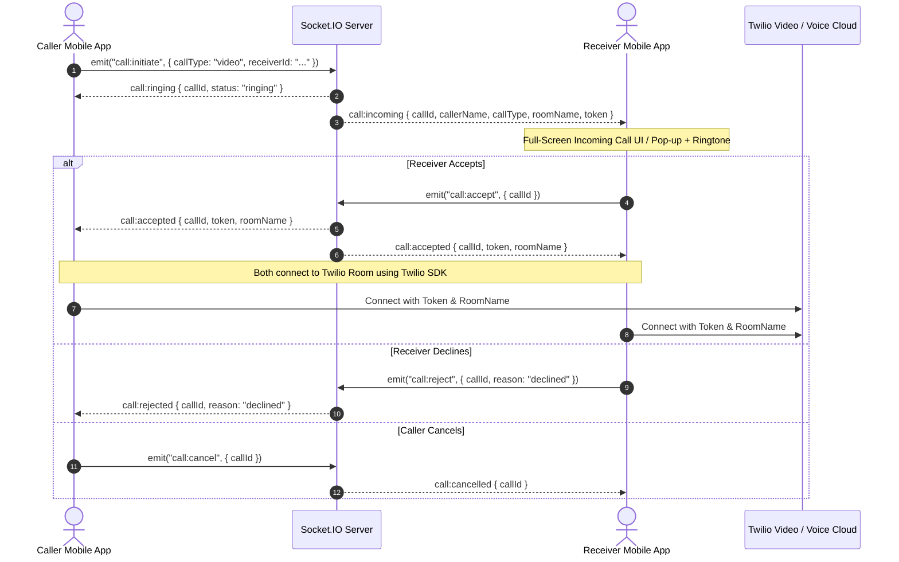
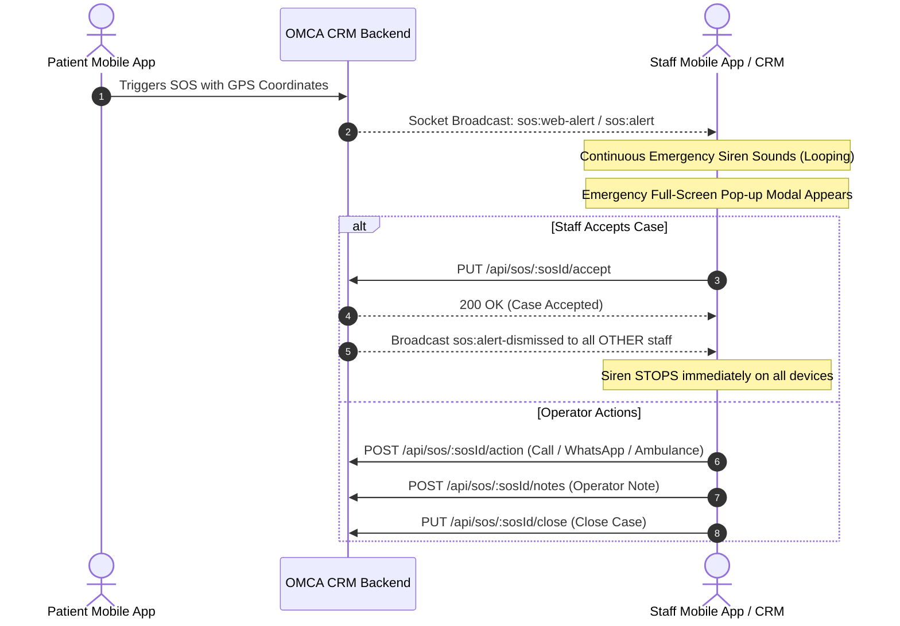

# OMCA Mobile Developer Master API Specification
**For iOS (Swift) & Android (Kotlin) Mobile Applications**  
**Version:** 2.4.0 (Production Release)  
**Scope:** Staff Authentication, Profile Management, Realtime Socket.IO, Twilio Voice & Video Calls, SOS Emergency Alerts & Popups, 1-on-1 & Group Chat, Master Dropdowns (Staff, Patients, Roles, Hospitals, Countries), Case Assignments, Push Notifications

---

## 1. System Architecture & Base Endpoints

| Resource | Value | Notes & Recommendations |
| :--- | :--- | :--- |
| **REST API Base URL** | `https://mobappssolutiondevelopment.com/omca_crm/api/` | Standard REST endpoints append directly to this base |
| **Media / Storage URL** | `https://mobappssolutiondevelopment.com/omca_crm/` | Prepend to all relative image and attachment paths (`uploads/...`) |
| **Socket.IO Host** | `https://mobappssolutiondevelopment.com` | Base domain for WebSocket connection |
| **Socket.IO Custom Path**| `/omca_crm/socket.io` | **CRITICAL**: Mobile Socket clients MUST set this custom path |
| **Socket Transports** | `["websocket", "polling"]` | WebSocket with polling fallback |

---

## 2. Authentication & Global Request Standards

### 2.1 Request Headers
Every protected endpoint requires the JWT Bearer token obtained during login:

```http
Authorization: Bearer <JWT_TOKEN>
Content-Type: application/json
```

For file uploads (profile picture or chat media attachments):
```http
Authorization: Bearer <JWT_TOKEN>
Content-Type: multipart/form-data; boundary=<BOUNDARY>
```

---

## 3. Module 1: Staff Authentication & Profile Management

### 3.1 Staff Login
Authenticates authorized staff (Coordinators, Supervisors, Operations Managers, Directors, Admins) and returns the JWT session token, staff profile, role, and permissions.

- **Endpoint:** `POST /api/login`
- **URL:** `https://mobappssolutiondevelopment.com/omca_crm/api/login`
- **Auth:** Public
- **Headers:** `Content-Type: application/json` (Optional: `x-latitude`, `x-longitude`, `ipAddress`)

#### Request Payload
```json
{
  "email": "coordinator@omca.com",
  "password": "SecurePassword123"
}
```

#### Success Response (`200 OK`)
```json
{
  "token": "eyJhbGciOiJIUzI1NiIsInR5cCI6IkpXVCJ9.eyJ1c2VySWQiOiI2NjRiOGE3ZjFlNGQzYTAwMWU5YTVjMTIiLCJyb2xlIjoiQ29vcmRpbmF0b3IifQ...",
  "details": {
    "_id": "664b8a7f1e4d3a001e9a5c12",
    "name": "Dr. Sarah Jenkins",
    "first_name": "Sarah",
    "last_name": "Jenkins",
    "email": "coordinator@omca.com",
    "role": "Coordinator",
    "phone": "9876543210",
    "phone_code": "+91",
    "gender": "Female",
    "profileImage": "uploads/staff/sarah_664b.jpg",
    "hospital_id": "1",
    "permissions": [
      "/Dashboard",
      "/Messages",
      "/SOS_Emergency",
      "/Manage_Patients"
    ]
  },
  "message": "Login successful"
}
```

### 3.2 Get Staff Profile Details
- **Endpoint:** `GET /api/get_details/:userId`
- **URL:** `https://mobappssolutiondevelopment.com/omca_crm/api/get_details/664b8a7f1e4d3a001e9a5c12`
- **Auth:** Bearer Token

#### Success Response (`200 OK`)
```json
{
  "success": true,
  "details": {
    "_id": "664b8a7f1e4d3a001e9a5c12",
    "name": "Dr. Sarah Jenkins",
    "email": "coordinator@omca.com",
    "role": "Coordinator",
    "phone_no": "9876543210",
    "phoneCode": "+91",
    "status": 1,
    "accessCountries": ["India", "UAE", "Kenya"]
  }
}
```

### 3.3 Update Staff Profile
- **Endpoint:** `PUT /api/update_staff/:userId` (or `PUT /api/user/update_patient/:userId`)
- **Headers:** `Content-Type: multipart/form-data`
- **Form Data Fields:**
  - `name`: String
  - `phone_no`: String
  - `phoneCode`: String
  - `image`: File (JPEG/PNG)

### 3.4 Change Password
- **Endpoint:** `POST /api/change_password`
- **Payload:**
```json
{
  "userId": "664b8a7f1e4d3a001e9a5c12",
  "oldPassword": "OldPassword123",
  "newPassword": "NewStrongPassword456"
}
```

---

## 4. Module 2: Realtime Socket.IO Connection Lifecycle

### 4.1 Connection Setup
Establish connection to the custom Socket.IO path:

```javascript
const socket = io("https://mobappssolutiondevelopment.com", {
  path: "/omca_crm/socket.io",
  transports: ["websocket", "polling"],
  reconnection: true,
  reconnectionDelay: 3000
});
```

### 4.2 Handshake & Room Subscription Sequence



1. **Step 1 - Connect**: Listen for `connect`.
2. **Step 2 - Authenticate**:
   ```javascript
   socket.emit("authenticate", { token: "<JWT>", userId: "<USER_ID>" });
   ```
3. **Step 3 - Subscribe to SOS Emergency Rooms**:
   ```javascript
   socket.emit("sos:subscribe");
   ```
   Server automatically subscribes socket to `sos-role:<ROLE>` (e.g. `sos-role:Coordinator`, `sos-role:Supervisor`, `sos-role:Director`).
4. **Step 4 - Subscribe to CRM Online Presence**:
   ```javascript
   socket.emit("crm:subscribe");
   ```
5. **Step 5 - Keepalive Heartbeat**:
   Emit `heartbeat` every 30 seconds to maintain presence.

---

## 5. Module 3: Twilio Voice & Video Calling System

### 5.1 Calling Architecture & Signaling Flow



---

### 5.2 Socket Signaling Events for Calling

#### A. Client Emits (Mobile ➔ Server)

| Event | Payload | Description |
| :--- | :--- | :--- |
| **`call:initiate`** | `{ callType: "video"|"audio", receiverId, receiverIds: [...], chatId, groupName }` | Start 1-on-1 or group call |
| **`call:accept`** | `{ callId: "..." }` | Accept incoming call |
| **`call:reject`** | `{ callId: "...", reason: "declined" }` | Reject incoming call |
| **`call:cancel`** | `{ callId: "..." }` | Cancel outgoing call before answer |
| **`call:end`** | `{ callId: "...", endForAll: false }` | Hang up / leave call |
| **`call:toggle_media`** | `{ callId: "...", mediaType: "audio"|"video", enabled: true|false }` | Mute/unmute microphone or camera |

#### B. Server Emits (Server ➔ Mobile)

| Event | Payload | Action Required on Mobile |
| :--- | :--- | :--- |
| **`call:incoming`** | `{ callId, callerId, callerName, callerAvatar, callType, roomName, token, isGroup, groupName }` | **Show Incoming Call Pop-up / Fullscreen UI + play ringtone** |
| **`call:ringing`** | `{ callId, status: "ringing" }` | Update caller UI to "Ringing..." |
| **`call:accepted`** | `{ callId, token, roomName }` | Stop ringtone; Connect to Twilio Room using `token` & `roomName` |
| **`call:rejected`** | `{ callId, reason }` | Stop ringtone; Display "Call Declined" and dismiss |
| **`call:cancelled`** | `{ callId }` | Dismiss incoming call pop-up; stop ringtone |
| **`call:ended`** | `{ callId }` | Disconnect from Twilio Room; close call screen |
| **`call:participant_joined`** | `{ callId, userId, userName }` | Render new participant video/audio tile |
| **`call:participant_left`** | `{ callId, userId }` | Remove participant tile |
| **`call:media_toggled`** | `{ callId, userId, mediaType, enabled }` | Show/hide peer camera or muted icon |
| **`call:busy`** | `{ callId }` | Target is on another call |
| **`call:missed`** | `{ callId }` | Unanswered call timed out |

---

### 5.3 Twilio Room Connection (Mobile SDKs)

Once `call:accepted` is received (or via `token` in `call:incoming`):

#### iOS (Swift - `TwilioVideo` Pod)
```swift
import TwilioVideo

class VideoCallManager: NSObject, RoomDelegate {
    var room: Room?
    var localAudioTrack = LocalAudioTrack(options: nil, enabled: true, name: "microphone")
    var localVideoTrack = LocalVideoTrack(options: nil, enabled: true, name: "camera")

    func connectToTwilio(token: String, roomName: String) {
        let connectOptions = ConnectOptions(token: token) { builder in
            builder.roomName = roomName
            if let audio = self.localAudioTrack { builder.audioTracks = [audio] }
            if let video = self.localVideoTrack { builder.videoTracks = [video] }
        }
        self.room = TwilioVideoSDK.connect(options: connectOptions, delegate: self)
    }

    func roomDidConnect(room: Room) {
        print("Connected to Twilio Room: (room.name)")
    }
}
```

#### Android (Kotlin - `com.twilio:video-android`)
```kotlin
import com.twilio.video.*

class VideoCallManager(private val context: Context) : Room.Listener {
    private var room: Room? = null
    private val localAudioTrack = LocalAudioTrack.create(context, true, "microphone")
    private val localVideoTrack = LocalVideoTrack.create(context, true, CameraCapturer(context, CameraCapturer.CameraSource.FRONT_CAMERA), "camera")

    fun connectToTwilio(token: String, roomName: String) {
        val connectOptions = ConnectOptions.Builder(token)
            .roomName(roomName)
            .audioTracks(listOf(localAudioTrack))
            .videoTracks(listOf(localVideoTrack))
            .build()
        room = Video.connect(context, connectOptions, this)
    }

    override fun onConnected(room: Room) {
        Log.d("TWILIO", "Connected to room: ${room.name}")
    }
    override fun onConnectFailure(room: Room, e: TwilioException) {
        Log.e("TWILIO", "Connection error: ${e.message}")
    }
    override fun onDisconnected(room: Room, e: TwilioException?) {}
    override fun onParticipantConnected(room: Room, remoteParticipant: RemoteParticipant) {}
    override fun onParticipantDisconnected(room: Room, remoteParticipant: RemoteParticipant) {}
    override fun onRecordingStarted(room: Room) {}
    override fun onRecordingStopped(room: Room) {}
}
```

---

### 5.4 Call REST Endpoints

#### 1. Generate / Refresh Token
- **Endpoint:** `POST /api/call/token`
- **Payload:** `{ "userId": "<USER_ID>", "roomName": "<ROOM_NAME>" }`
- **Response:** `{ "token": "<TWILIO_ACCESS_TOKEN>", "roomName": "..." }`

#### 2. Get Call History
- **Endpoint:** `GET /api/call/history?userId=<ID>&page=1&limit=20&filter=all`

#### 3. Get Missed Calls Count
- **Endpoint:** `GET /api/call/missed-count?userId=<ID>`

#### 4. Mark Missed Calls Read
- **Endpoint:** `POST /api/call/mark-read`
- **Payload:** `{ "userId": "<USER_ID>", "callId": "<OPTIONAL_CALL_ID>" }`

#### 5. Check Active Call Status
- **Endpoint:** `GET /api/call/active-status?userId=<ID>`
- **Response:** `{ "isInCall": false }`

---

## 6. Module 4: SOS Emergency Alert & Pop-up System

### 6.1 SOS Emergency Lifecycle



---

### 6.2 SOS Realtime Socket Events

#### 1. Incoming Alert: `sos:web-alert` / `sos:alert`
Broadcast to all staff subscribed to `sos-role:<ROLE>`.

```json
{
  "type": "SOS_NEW_ALERT",
  "sosId": "664b912a1e4d3a001e9a5e89",
  "emergencyCaseId": "EM-2026-0891",
  "title": "CRITICAL SOS ALERT",
  "receivedAt": "2026-11-03T09:15:20.000Z",
  "status": "Alert Received",
  "patient": {
    "name": "David Miller",
    "mobile": "+919876543210",
    "age": 58,
    "gender": "Male",
    "status": "Severe chest pain and shortness of breath"
  },
  "location": {
    "label": "Connaught Place, New Delhi",
    "latitude": 28.6304,
    "longitude": 77.2177,
    "mapsUrl": "https://www.google.com/maps/search/?api=1&query=28.6304,77.2177",
    "distanceKm": "2.4",
    "etaMinutes": "8"
  },
  "medicalHistory": ["Hypertension", "Type 2 Diabetes", "Post-Angioplasty (2023)"],
  "allergies": ["Penicillin", "Sulfa drugs"],
  "medication": ["Aspirin 75mg", "Metformin 500mg", "Amlodipine 5mg"],
  "emergencyContact": {
    "name": "Jane Miller",
    "relation": "Spouse",
    "phone": "+919811223344"
  },
  "ambulance": {
    "id": "AMB-04",
    "driver": "Rajesh Kumar",
    "etaMinutes": "8"
  }
}
```

#### 2. Alert Dismissed: `sos:alert-dismissed`
Emitted when **any** operator accepts or dismisses the case.
- **Payload:** `{ "sosId": "664b912a1e4d3a001e9a5e89", "acceptedBy": "Dr. Sarah" }`
- **Mobile Action:**
  1. **Stop emergency siren immediately.**
  2. Dismiss or update the emergency popup to show *"Accepted by Dr. Sarah"*.

---

### 6.3 Emergency Siren Sound Pattern
To ensure operators never miss an alert, OMCA CRM plays a continuous looping two-tone emergency siren (not a single beep):
* **Tone 1:** 960 Hz for 0.4 seconds
* **Tone 2:** 770 Hz for 0.4 seconds
* **Looping:** Runs continuously until `acceptSosCase()` or `sos:alert-dismissed` is received.

---

### 6.4 Emergency Pop-up Modal Blueprint
When `sos:web-alert` arrives:
1. **Header**: Flashing red/orange warning icon, Case ID, elapsed timer (`"Received 12 seconds ago"`), and close button.
2. **Patient Info Card**: Patient Name, Mobile with one-tap dial button, Age, Gender, Conditions.
3. **Medical Alert Card**: Red badge for **Allergies**, yellow badge for **Current Medication**, medical history pills.
4. **Emergency Contact**: One-tap phone button to call spouse/next of kin.
5. **Live Location Card**: GPS Address, Distance to nearest ambulance, and **"Open in Google Maps"** button (`mapsUrl`).
6. **Action Bar (Operator Controls)**:
   * **[ACCEPT CASE]** (Primary green button): Calls `PUT /api/sos/:sosId/accept`.
   * **[CALL PATIENT]**: Initiates phone/Twilio call to patient mobile.
   * **[DISPATCH AMBULANCE]**: Triggers nearest ambulance dispatch.
   * **[AIR AMBULANCE]**: Initiates air evacuation protocol.
   * **[CLOSE CASE]**: Resolves the emergency with operator notes.

---

### 6.5 SOS REST Endpoints

#### 1. Get Unaccepted SOS Alerts
- **Endpoint:** `GET /api/sos/dashboard/alerts`
- **Headers:** `Authorization: Bearer <token>`
- **Response:** Array of unaccepted SOS alerts.

#### 2. Get Single SOS Case Dashboard
- **Endpoint:** `GET /api/sos/dashboard/:sosId`

#### 3. Accept SOS Case
- **Endpoint:** `PUT /api/sos/:sosId/accept`
- **Payload:** `{}`
- **Response:** `{ "success": true, "message": "Case accepted successfully" }`

#### 4. Post Action Taken on SOS
- **Endpoint:** `POST /api/sos/:sosId/action`
- **Payload:**
```json
{
  "type": "Call",
  "notes": "Patient advised to remain seated until ambulance arrives"
}
```
*(Allowed `type` values: `"Call"`, `"WhatsApp"`, `"DispatchAmbulance"`, `"AirAmbulance"`, `"OpenMaps"`)*

#### 5. Add Operator Timeline Note
- **Endpoint:** `POST /api/sos/:sosId/notes`
- **Payload:** `{ "note": "Ambulance arriving at patient location" }`

#### 6. Live Tracking (Ambulance + Patient GPS)
- **Endpoint:** `GET /api/sos/:sosId/tracking`
- **Response:** `{ "user": { "lat": 28.6304, "lng": 77.2177 }, "ambulance": { "lat": 28.6250, "lng": 77.2100, "etaMinutes": 5 } }`

#### 7. Update Ambulance Location (Driver App)
- **Endpoint:** `PUT /api/sos/:sosId/ambulance-location`
- **Payload:** `{ "latitude": 28.6250, "longitude": 77.2100, "etaMinutes": 5 }`

#### 8. Close / Resolve SOS Case
- **Endpoint:** `PUT /api/sos/:sosId/close`
- **Payload:** `{ "notes": "Patient admitted to Apollo Hospital Emergency Room" }`

---

## 7. Module 5: Real-time 1-on-1 & Group Chat

### 7.1 Chat REST Endpoints

#### 1. Fetch Conversations List
- **Endpoint:** `GET /api/chat/list?userId=<USER_ID>`
- **Response:**
```json
[
  {
    "_id": "664c12001e4d3a001e9a7100",
    "name": "John Doe",
    "isGroup": false,
    "lastMessage": {
      "text": "Doctor review has been uploaded",
      "createdAt": "2026-11-03T09:30:00.000Z",
      "senderId": "664b8a7f1e4d3a001e9a5c12"
    },
    "unreadCount": 2,
    "participants": [
      { "_id": "664b8a7f1e4d3a001e9a5c12", "name": "Dr. Sarah", "role": "Coordinator" },
      { "_id": "6724cb10e0f0c23a00000001", "name": "John Doe", "role": "Patient" }
    ]
  }
]
```

#### 2. Fetch Chat Messages (Paginated)
- **Endpoint:** `GET /api/chat/messages/:chatId?userId=<ID>&page=1&limit=20`

#### 3. Start 1-on-1 Chat
- **Endpoint:** `POST /api/chat/start`
- **Payload:** `{ "userId": "<MY_USER_ID>", "contactUserId": "<OTHER_USER_ID>" }`

#### 4. Send Message (REST Fallback / Attachments)
- **Endpoint:** `POST /api/chat/send`
- **For Text:** `Content-Type: application/json`
  ```json
  {
    "userId": "<MY_USER_ID>",
    "chatId": "<CHAT_ID>",
    "contactUserId": "<RECIPIENT_ID>",
    "message": "Hello, your prescription is ready."
  }
  ```
- **For Attachments:** `Content-Type: multipart/form-data`
  - `userId`, `chatId`, `contactUserId`, `message` (caption), `attachment` (file).

#### 5. Create Group Chat
- **Endpoint:** `POST /api/chat/group/create`
- **Payload:**
```json
{
  "userId": "<MY_USER_ID>",
  "name": "Patient Care Team - John Doe",
  "memberIds": ["664b8a7f1e4d3a001e9a5c12", "65b98f21e0f0c23a87654321"]
}
```

#### 6. Add Member to Group
- **Endpoint:** `POST /api/chat/group/add-member`
- **Payload:** `{ "userId": "<MY_ID>", "chatId": "<CHAT_ID>", "memberIds": ["<NEW_MEMBER_ID>"] }`

#### 7. Remove Member from Group
- **Endpoint:** `POST /api/chat/group/remove-member`
- **Payload:** `{ "userId": "<MY_ID>", "chatId": "<CHAT_ID>", "memberId": "<MEMBER_ID>" }`

#### 8. Mark Chat as Read
- **Endpoint:** `POST /api/chat/mark-read`
- **Payload:** `{ "userId": "<MY_ID>", "chatId": "<CHAT_ID>" }`

#### 9. Search Users & Patients for Chat
- **Endpoint:** `GET /api/chat/users?search=john&type=all&page=1&limit=50`

---

### 7.2 Real-time Chat Socket Events

| Event Name | Direction | Payload | Usage |
| :--- | :--- | :--- | :--- |
| **`joinChat`** | Client ➔ Server | `{ chatId }` | Join chat room to receive live messages |
| **`leaveChat`** | Client ➔ Server | `{ chatId }` | Leave chat room when closing screen |
| **`chat:send`** | Client ➔ Server | `{ chatId, message, contactUserId }` | Send instant text message |
| **`chat:message`**| Server ➔ Client | `{ _id, chatId, senderId, senderName, message, attachment, createdAt }` | Receive new incoming message |
| **`chat:read`** | Client ➔ Server | `{ chatId, userId }` | Broadcast read receipt |
| **`chat:read`** | Server ➔ Client | `{ chatId, userId, readAt }` | Update double tick to blue tick |
| **`presence:get`** | Client ➔ Server | `{}` | Request current list of online users |
| **`presence:online-users`**| Server ➔ Client | `["<USER_ID_1>", "<USER_ID_2>"]` | Array of currently connected user IDs |
| **`presence:update`**| Server ➔ Client | `{ userId, status: "online"|"offline" }` | Single user online/offline status change |

---

## 8. Module 6: Native Mobile Implementation Architecture

### 8.1 Swift (iOS) Architecture

```swift
// OMCASocketManager.swift
import Foundation
import SocketIO

final class OMCASocketManager {
    static let shared = OMCASocketManager()
    private var manager: SocketManager?
    private(set) var socket: SocketIOClient?

    private init() {}

    func connect(token: String, userId: String) {
        guard let url = URL(string: "https://mobappssolutiondevelopment.com") else { return }

        manager = SocketManager(
            socketURL: url,
            config: [
                .path("/omca_crm/socket.io"),
                .transports([.websocket, .polling]),
                .forceWebsockets(true),
                .reconnects(true),
                .reconnectWait(3)
            ]
        )
        socket = manager?.defaultSocket

        socket?.on(clientEvent: .connect) { [weak self] _, _ in
            print("Socket connected!")
            self?.socket?.emit("authenticate", ["token": token, "userId": userId])
            self?.socket?.emit("sos:subscribe")
            self?.socket?.emit("crm:subscribe")
        }

        // SOS Emergency Alert Listener
        socket?.on("sos:web-alert") { data, _ in
            guard let alert = data.first as? [String: Any] else { return }
            NotificationCenter.default.post(name: .onSosAlertReceived, object: nil, userInfo: alert)
        }

        socket?.on("sos:alert-dismissed") { data, _ in
            NotificationCenter.default.post(name: .onSosAlertDismissed, object: nil)
        }

        // Calling Signaling Listeners
        socket?.on("call:incoming") { data, _ in
            guard let callData = data.first as? [String: Any] else { return }
            NotificationCenter.default.post(name: .onIncomingCall, object: nil, userInfo: callData)
        }

        socket?.on("call:accepted") { data, _ in
            guard let callData = data.first as? [String: Any] else { return }
            NotificationCenter.default.post(name: .onCallAccepted, object: nil, userInfo: callData)
        }

        // Chat Message Listener
        socket?.on("chat:message") { data, _ in
            guard let msg = data.first as? [String: Any] else { return }
            NotificationCenter.default.post(name: .onChatMessageReceived, object: nil, userInfo: msg)
        }

        socket?.connect()
    }
}

extension Notification.Name {
    static let onSosAlertReceived = Notification.Name("OMCA_SOS_ALERT")
    static let onSosAlertDismissed = Notification.Name("OMCA_SOS_DISMISSED")
    static let onIncomingCall = Notification.Name("OMCA_CALL_INCOMING")
    static let onCallAccepted = Notification.Name("OMCA_CALL_ACCEPTED")
    static let onChatMessageReceived = Notification.Name("OMCA_CHAT_MESSAGE")
}
```

---

### 8.2 Kotlin (Android) Architecture

```kotlin
// OMCASocketManager.kt
package com.omca.crm.socket

import android.content.Context
import android.content.Intent
import android.util.Log
import io.socket.client.IO
import io.socket.client.Socket
import org.json.JSONObject

object OMCASocketManager {
    private const val SOCKET_URL = "https://mobappssolutiondevelopment.com"
    private const val SOCKET_PATH = "/omca_crm/socket.io"
    private var socket: Socket? = null

    fun connect(context: Context, token: String, userId: String) {
        val options = IO.Options().apply {
            path = SOCKET_PATH
            transports = arrayOf("websocket", "polling")
            reconnection = true
            reconnectionDelay = 3000
        }

        socket = IO.socket(SOCKET_URL, options)

        socket?.on(Socket.EVENT_CONNECT) {
            Log.d("SOCKET", "Connected successfully")
            val auth = JSONObject().apply {
                put("token", token)
                put("userId", userId)
            }
            socket?.emit("authenticate", auth)
            socket?.emit("sos:subscribe")
            socket?.emit("crm:subscribe")
        }

        // Emergency SOS Alert
        socket?.on("sos:web-alert") { args ->
            if (args.isNotEmpty() && args[0] is JSONObject) {
                val alert = args[0] as JSONObject
                // Launch High-Priority Fullscreen Activity / Dialog
                val intent = Intent("com.omca.crm.SOS_ALERT").apply {
                    putExtra("alertData", alert.toString())
                }
                context.sendBroadcast(intent)
            }
        }

        socket?.on("sos:alert-dismissed") {
            context.sendBroadcast(Intent("com.omca.crm.SOS_DISMISSED"))
        }

        // Incoming Call Signaling
        socket?.on("call:incoming") { args ->
            if (args.isNotEmpty() && args[0] is JSONObject) {
                val callData = args[0] as JSONObject
                val intent = Intent("com.omca.crm.CALL_INCOMING").apply {
                    putExtra("callData", callData.toString())
                }
                context.sendBroadcast(intent)
            }
        }

        // Realtime Chat Message
        socket?.on("chat:message") { args ->
            if (args.isNotEmpty() && args[0] is JSONObject) {
                val message = args[0] as JSONObject
                val intent = Intent("com.omca.crm.CHAT_MESSAGE").apply {
                    putExtra("message", message.toString())
                }
                context.sendBroadcast(intent)
            }
        }

        socket?.connect()
    }

    fun emit(event: String, data: JSONObject) {
        socket?.emit(event, data)
    }
}
```

---

## 9. Module 7: Background & Push Notifications (FCM / APNs)

When the mobile app is minimized or terminated:
1. **SOS Emergency**:
   - Deliver **High-Priority Data Message** with `priority: "high"`.
   - On Android: Start a foreground service that loops the siren alarm and displays the full-screen intent.
   - On iOS: Use Critical Alerts entitlement (`com.apple.developer.usernotifications.critical-alerts`) to bypass Do-Not-Disturb and play siren audio.
2. **Twilio Voice / Video Incoming Calls**:
   - On iOS: Send **VoIP Push Notification** (PushKit `PKPushRegistry`) which triggers the native system CallKit incoming call screen.
   - On Android: Send high-priority FCM message and launch full-screen incoming call Activity via `TelecomManager` or `ConnectionService`.


---

## 10. Module 8: Master Dropdowns, Staff & Patient Management APIs

Mobile applications frequently require fast, lightweight dropdown feeds, searchable pickers, and filter menus for selecting **Staff members**, **Patients**, **Roles**, **Hospitals**, **Countries**, and **Workflow Statuses**.

All dropdown endpoints require Bearer Token Authentication unless noted otherwise.

---

### 10.1 Mobile Dropdown Strategy & Performance Best Practices

| Data Type | Endpoint / Source | Mobile Strategy | Recommended Caching TTL |
| :--- | :--- | :--- | :--- |
| **System Roles & Permissions** | `GET /api/getAllRoles` | Load on app start / login | 24 Hours (Local SQLite / Room / CoreData) |
| **Countries & Dial Codes** | `GET /api/getActiveCountries` | Load on app start | 24 Hours |
| **Hospitals Master** | `POST /api/crm/hospital_list` | Load on app start | 12 Hours |
| **Treatment Courses** | `POST /api/crm/treatment_list` | Load on app start | 12 Hours |
| **Active Staff by Role** | `GET /api/user/get_staff_by_role?role=...` | Load when picker opens | 1 Hour (in-memory or cache) |
| **Active Coordinators** | `GET /api/user/get_coordinators` | Load when assigning coordinator | 30 Minutes |
| **Patient Status Enums** | Static Canonical List (`PATIENT_STATUS_OPTIONS`) | Bundled client-side constant | Bundled with app release |
| **Patients Master Lookup** | `GET /api/all_patients?search=...` | Dynamic typeahead with 300ms debounce | No cache (live query) |
| **My Assigned Patients** | `GET /api/user/my_assigned_patients` | Worklist tab / fast-picker | Cache until pull-to-refresh or assignment |

---

### 10.2 Staff Dropdowns & Role Lookups

#### 1. Get Staff by Specific Role
Fetches all active staff users filtered by system role. Ideal for role-specific assignment dialogs (e.g., Coordinator picker, Nurse picker, Doctor selector).

- **Endpoint:** `GET /api/user/get_staff_by_role`
- **Fallback URL:** `GET /api/get_staff_by_role`
- **Auth:** Bearer Token
- **Query Parameters:**
  - `role` (Optional): Filter by role name (e.g., `"Coordinator"`, `"Supervisor"`, `"Doctor"`, `"Nurse"`, `"Physiotherapist"`, `"Director"`). Omit to retrieve all active staff.
  - `status` (Optional): `1` for active only (default).

##### Sample Request
```http
GET /api/user/get_staff_by_role?role=Coordinator HTTP/1.1
Host: mobappssolutiondevelopment.com
Authorization: Bearer <JWT_TOKEN>
```

##### Success Response (`200 OK`)
```json
{
  "success": true,
  "data": [
    {
      "_id": "664b8a7f1e4d3a001e9a5c12",
      "name": "Dr. Sarah Jenkins",
      "email": "sarah.jenkins@omca.com",
      "role": "Coordinator",
      "phone_no": "9876543210",
      "dial_code": "+91",
      "gender": "Female",
      "profileImage": "uploads/staff/sarah_664b.jpg",
      "status": 1
    },
    {
      "_id": "664b8f021e4d3a001e9a5c99",
      "name": "Ahmed Al-Mansoor",
      "email": "ahmed.m@omca.com",
      "role": "Coordinator",
      "phone_no": "501234567",
      "dial_code": "+971",
      "gender": "Male",
      "profileImage": "uploads/staff/ahmed_664b.jpg",
      "status": 1
    }
  ]
}
```

---

#### 2. Get All Active Coordinators
Dedicated helper to fetch coordinators specifically for patient assignment or transfer workflows.

- **Endpoint:** `GET /api/user/get_coordinators`
- **Fallback URLs:** `GET /api/get_coordinators`, `GET /api/coordinators`
- **Auth:** Bearer Token

##### Success Response (`200 OK`)
```json
{
  "success": true,
  "data": [
    {
      "_id": "664b8a7f1e4d3a001e9a5c12",
      "name": "Dr. Sarah Jenkins",
      "email": "sarah.jenkins@omca.com",
      "phone_no": "9876543210",
      "dial_code": "+91",
      "role": "Coordinator"
    }
  ]
}
```

---

#### 3. Get All System Roles Dropdown
Returns all registered system roles for user creation, filter chips, and role pickers.

- **Endpoint:** `GET /api/getAllRoles`
- **URL:** `https://mobappssolutiondevelopment.com/omca_crm/api/getAllRoles`
- **Auth:** Bearer Token

##### Success Response (`200 OK`)
```json
{
  "success": true,
  "data": [
    { "_id": "664b801a1e4d3a001e9a5100", "role": "Super Admin" },
    { "_id": "664b802b1e4d3a001e9a5101", "role": "Coordinator" },
    { "_id": "664b803c1e4d3a001e9a5102", "role": "Supervisor" },
    { "_id": "664b804d1e4d3a001e9a5103", "role": "Operations Manager" },
    { "_id": "664b805e1e4d3a001e9a5104", "role": "Director" },
    { "_id": "664b806f1e4d3a001e9a5105", "role": "Physiotherapist" },
    { "_id": "664b80701e4d3a001e9a5106", "role": "Referral Partner" }
  ]
}
```

---

#### 4. Get All Staff Master Directory (Paginated & Searchable)
Used for searchable staff directories, adding members to group chats, and administrative lists.

- **Endpoint:** `GET /api/get_all_user_staffs`
- **Auth:** Bearer Token
- **Query Parameters:**
  - `page` (Integer, default `1`)
  - `limit` (Integer, default `50`)
  - `search` (String): Search by name, email, or phone
  - `role` (String, Optional): Filter by specific role

##### Success Response (`200 OK`)
```json
{
  "success": true,
  "data": [
    {
      "_id": "664b8a7f1e4d3a001e9a5c12",
      "name": "Dr. Sarah Jenkins",
      "email": "sarah.jenkins@omca.com",
      "role": "Coordinator",
      "phone_no": "9876543210",
      "dial_code": "+91",
      "country": "India",
      "profileImage": "uploads/staff/sarah.jpg",
      "status": 1
    }
  ],
  "total": 38,
  "currentPage": 1,
  "totalPages": 1
}
```

---

#### 5. Get Physiotherapy Staff Dropdown
Retrieves all doctors and therapists assigned to the Physiotherapy department.

- **Endpoint:** `GET /api/physiotherapy/staff`
- **Fallback URL:** `GET /api/get_physiotherapy_staffs`
- **Auth:** Bearer Token

##### Success Response (`200 OK`)
```json
{
  "success": true,
  "data": [
    {
      "_id": "6650a1b2c3d4e5f607182930",
      "name": "Dr. Rajesh Sharma",
      "role": "Physiotherapist",
      "email": "rajesh.physio@omca.com",
      "phone_no": "9811223344",
      "dial_code": "+91"
    }
  ]
}
```

---

### 10.3 Patients Master Dropdowns & Data Feeds

#### 1. All Patients (Searchable Dropdown & Typeahead)
Primary patient selection endpoint across the mobile app (used in Appointment creation, Order placement, Prescription upload, Pick & Drop scheduling, and Chat initiation).

- **Endpoint:** `GET /api/all_patients`
- **Auth:** Bearer Token
- **Query Parameters:**
  - `search` (String): Search keyword (matches Patient ID, Name, Disease, Mobile)
  - `page` (Integer, default `1`)
  - `limit` (Integer, default `20` for dropdowns, `50` for lists)
  - `p_status` (String, Optional): Filter by workflow status (e.g., `Ongoing Treatment`, `Arriving`)
  - `country` (String, Optional): Filter by patient nationality / source country
  - `treatingIn` (String, Optional): Filter by destination country (e.g. `India`, `UAE`)
  - `treatment` (String, Optional): Filter by treatment course name
  - `patient_type_new` (String, Optional): Filter by type (`Foundation`, `Private`, `Insurance`)

##### Success Response (`200 OK`)
```json
{
  "details": [
    {
      "_id": "664b8d4f1e4d3a001e9a5c88",
      "patientId": "OMCA-2026-1042",
      "patient_name": "Michael Roberts",
      "disease_name": "Knee Osteoarthritis",
      "age": 52,
      "gender": "Male",
      "p_status": "Ongoing Treatment",
      "patient_type_new": "Private",
      "country": "Kenya",
      "treatingIn": "India",
      "emergency_contact_no": "+254712345678",
      "email": "m.roberts@gmail.com",
      "coordinatorId": "664b8a7f1e4d3a001e9a5c12",
      "coordinatorName": "Dr. Sarah Jenkins",
      "hospital_name": "Apollo Hospitals Delhi",
      "profileImage": "uploads/patients/michael_664b.jpg"
    }
  ],
  "pagination": {
    "totalRecords": 142,
    "currentPage": 1,
    "totalPages": 8,
    "perPage": 20
  }
}
```

---

#### 2. My Assigned Patients (Coordinator Personalized Worklist)
Returns only the patients currently assigned to the authenticated Coordinator / Staff member.

- **Endpoint:** `GET /api/user/my_assigned_patients`
- **Fallback URL:** `GET /api/patient/assigned_to_me`
- **Auth:** Bearer Token
- **Query Parameters:**
  - `page` (Integer, default `1`)
  - `limit` (Integer, default `20`)
  - `isAll` (Boolean, default `true` to return all assigned records)
  - `search` (String, Optional)
  - `p_status` (String, Optional)

##### Success Response (`200 OK`)
```json
{
  "success": true,
  "details": [
    {
      "_id": "664b8d4f1e4d3a001e9a5c88",
      "patientId": "OMCA-2026-1042",
      "patient_name": "Michael Roberts",
      "disease_name": "Knee Osteoarthritis",
      "p_status": "Ongoing Treatment",
      "country": "Kenya",
      "emergency_contact_no": "+254712345678",
      "assignedAt": "2026-10-15T08:30:00.000Z"
    }
  ]
}
```

---

#### 3. Single Patient Full Details
Fetches comprehensive patient demographics, medical history, vitals, assigned staff, documents, and travel itinerary.

- **Endpoint:** `GET /api/user/get_particular_patient/:patientId`
- **Fallback URL:** `GET /api/get_particular_patient/:patientId`
- **Auth:** Bearer Token

##### Success Response (`200 OK`)
```json
{
  "success": true,
  "data": {
    "_id": "664b8d4f1e4d3a001e9a5c88",
    "patientId": "OMCA-2026-1042",
    "patient_name": "Michael Roberts",
    "age": 52,
    "gender": "Male",
    "email": "m.roberts@gmail.com",
    "emergency_contact_no": "+254712345678",
    "country": "Kenya",
    "disease_name": "Knee Osteoarthritis",
    "p_status": "Ongoing Treatment",
    "patient_type_new": "Private",
    "coordinator": {
      "_id": "664b8a7f1e4d3a001e9a5c12",
      "name": "Dr. Sarah Jenkins",
      "email": "sarah.jenkins@omca.com",
      "phone_no": "9876543210"
    },
    "referral": {
      "referral_id": "REF-1002",
      "name": "Nairobi Health Care Partner"
    },
    "travel": {
      "flightNumber": "KQ-204",
      "arrivalDate": "2026-11-05T14:30:00.000Z",
      "departureDate": "2026-11-20T10:00:00.000Z",
      "hotelGuestHouse": "OMCA Guest House Suite 302"
    }
  }
}
```

---

#### 4. Travel Patients Feed
Feed of patients currently active in travel lifecycle (Arriving, Departing, Travelling Today). Used for Airport Pick & Drop and Travel Schedule tabs.

- **Endpoint:** `GET /api/get_travel_patients`
- **Auth:** Bearer Token

---

#### 5. Treatment Completed Patients
Feed of patients whose medical procedures are concluded, useful for post-treatment checkup pickers and feedback forms.

- **Endpoint:** `GET /api/get_treatment_completed_patients`
- **Auth:** Bearer Token

---

#### 6. Fast Patient Lookup by Phone Number
Used during incoming Twilio calls or WhatsApp chats to instantly recognize an existing patient by caller ID.

- **Endpoint:** `GET /api/checkPatientsByPhone?phone=<NUMBER>`
- **Auth:** Bearer Token
- **Response:** `{ "exists": true, "patient": { "_id": "...", "patient_name": "...", "patientId": "..." } }`

---

### 10.4 Canonical Patient Status & Category Enums

#### 1. Patient Status Workflow Enums (`p_status`)
Mobile developers should embed these canonical statuses for dropdown pickers, offline state machines, and colored UI status badges:

| Status Key / Value | Display Label | Badge Hex Color | Description | Requires Travel Dates? |
| :--- | :--- | :--- | :--- | :---: |
| `"In_Process"` | In Process | `#3B82F6` (Blue) | Initial medical inquiry / review | No |
| `"Confirmed"` | Confirmed | `#10B981` (Green) | Patient confirmed travel & treatment | No |
| `"Pending"` | Pending | `#F59E0B` (Amber) | Awaiting reports or approval | No |
| `"On Hold"` | On Hold | `#6B7280` (Gray) | Case paused by patient or hospital | No |
| `"Arriving"` | Arriving | `#8B5CF6` (Purple) | Incoming flight scheduled | **Yes** |
| `"Traveling Today"` | Traveling Today | `#EC4899` (Pink) | Flight in transit today | No |
| `"Travelled"` | Travelled | `#059669` (Dark Green) | Arrived at destination city | No |
| `"Ongoing Treatment"` | Ongoing Treatment | `#0284C7` (Sky Blue) | Admitted / undergoing medical procedures | No |
| `"Ongoing Fundraising"` | Ongoing Fundraising | `#D97706` (Orange) | Foundation / crowd funding in progress | No |
| `"Treatment Completed"`| Treatment Completed | `#15803D` (Forest Green)| Discharged from hospital care | No |
| `"Departing"` | Departing | `#6366F1` (Indigo) | Return flight scheduled | **Yes** |
| `"Preponed"` | Preponed | `#D946EF` (Fuchsia) | Travel moved to an earlier date | **Yes** |
| `"Postponed"` | Postponed | `#F97316` (Rust) | Travel delayed / rescheduled | **Yes** |
| `"Follow Up"` | Follow Up | `#14B8A6` (Teal) | Post-procedure routine consultation | No |
| `"Local Case"` | Local Case | `#64748B` (Slate) | Domestic patient (no cross-border travel) | No |
| `"Visit 1"` | Visit 1 | `#0284C7` (Sky Blue) | First clinical consultation | No |
| `"Visit 2"` | Visit 2 | `#0284C7` (Sky Blue) | Second review visit | No |
| `"Cancelled"` | Cancelled | `#EF4444` (Red) | Case cancelled / retracted | No |
| `"Passed Away"` | Passed Away | `#1E293B` (Dark Slate) | Patient expired | No |

> [!IMPORTANT]
> If a user selects **`Arriving`**, **`Departing`**, **`Preponed`**, or **`Postponed`**, the mobile UI **MUST** display a mandatory travel popup modal requesting:
> - Flight Number
> - Travel Date & Time
> - Airport of Departure & Arrival
> - Hotel / Guest House Name

---

#### 2. Update Patient Status API
Changes the workflow status of a patient.

- **Endpoint:** `PUT /api/changePatientStatus/:patientId`
- **Fallback URL:** `PUT /api/update_patient_status/:patientId`
- **Auth:** Bearer Token
- **Payload:**
```json
{
  "p_status": "Ongoing Treatment"
}
```

##### Success Response (`200 OK`)
```json
{
  "success": true,
  "message": "Patient status updated successfully",
  "p_status": "Ongoing Treatment"
}
```

---

#### 3. Patient Type / Category Options (`patient_type_new`)
Canonical funding / category options:
- `"Foundation"`: Sponsored by a charitable foundation or NGO
- `"Private"`: Self-funded patient
- `"Insurance"`: Covered by health insurance provider
- `"Insurance + Private"`: Split insurance and personal co-pay
- `"Referral"`: Sourced via external referral partner / agent
- `"None"`: Unclassified

---

### 10.5 Staff-to-Patient Assignment Workflows

#### 1. Assign Coordinator to Patient
Assigns or transfers care coordination of a patient to a specific coordinator.

- **Endpoint:** `POST /api/user/assign_patient_to_coordinator/:patientId`
- **Fallback URL:** `POST /api/assign_patient_to_coordinator/:patientId`
- **Auth:** Bearer Token
- **Payload:**
```json
{
  "coordinatorId": "664b8a7f1e4d3a001e9a5c12",
  "notes": "Assigned to Dr. Sarah for oncology protocol coordination."
}
```

##### Success Response (`200 OK`)
```json
{
  "success": true,
  "message": "Coordinator assigned to patient successfully",
  "assignedCoordinator": {
    "userId": "664b8a7f1e4d3a001e9a5c12",
    "name": "Dr. Sarah Jenkins",
    "role": "Coordinator"
  }
}
```

---

#### 2. Unassign Coordinator from Patient
Removes current coordinator assignment.

- **Endpoint:** `POST /api/user/unassign_patient_from_coordinator/:patientId`
- **Fallback URL:** `POST /api/unassign_patient_from_coordinator/:patientId`
- **Auth:** Bearer Token
- **Payload:**
```json
{
  "reason": "Handover to regional coordination team."
}
```

---

#### 3. Assign Physiotherapist to Patient
Assigns a therapy specialist to a patient case.

- **Endpoint:** `POST /api/physiotherapy/assign/:patientId`
- **Auth:** Bearer Token
- **Payload:**
```json
{
  "therapistId": "6650a1b2c3d4e5f607182930",
  "frequency": "Daily",
  "startDate": "2026-11-05",
  "notes": "Post-knee surgery rehabilitation therapy"
}
```

---

#### 4. Unassign Physiotherapist from Patient
- **Endpoint:** `POST /api/physiotherapy/unassign/:patientId`
- **Auth:** Bearer Token
- **Payload:** `{ "reason": "Rehabilitation sessions completed" }`

---

#### 5. Assign Referral Partner to Patient
- **Endpoint:** `POST /api/user/assign_referral/:patientId`
- **Fallback URL:** `POST /api/assign_referral/:patientId`
- **Payload:** `{ "referralId": "REF-1002" }`

---

#### 6. Multi-Disciplinary Care Team Assignment (Multiple Roles & Multiple Staff in Same Role)
OMCA CRM fully supports assigning multiple staff across different roles, as well as **multiple staff members to the exact same role** for a patient (e.g. Primary Coordinator, Attending Doctors, Day/Night Shift Nurses, Physiotherapists, Supervisors, and Calling Team).

##### How `assignedStaff` Works:
In `assignedStaff`, each staff member is tracked individually by their `userId` and `role`:

- **Multiple Staff Members in the Exact Same Role:**  
  You can assign **Nurse Sarah** AND **Nurse John** (or multiple Doctors, multiple Coordinators) to the same patient. Both are preserved simultaneously inside `patient.assignedStaff`:
  ```json
  "assignedStaff": [
    {
      "userId": "65b98f21e0f0c23a87654321",
      "name": "Nurse Sarah",
      "role": "Nurse",
      "email": "sarah.nurse@omca.com",
      "phone": "+919876543210",
      "notes": "Day shift nurse",
      "assignedAt": "2026-11-03T08:50:00.000Z"
    },
    {
      "userId": "65b98f21e0f0c23a87654322",
      "name": "Nurse John",
      "role": "Nurse",
      "email": "john.nurse@omca.com",
      "phone": "+919876543211",
      "notes": "Night shift nurse",
      "assignedAt": "2026-11-03T09:30:00.000Z"
    },
    {
      "userId": "65b98f21e0f0c23a87654323",
      "name": "Dr. Michael",
      "role": "Doctor",
      "email": "dr.michael@omca.com",
      "phone": "+919876543212",
      "notes": "Primary Physician",
      "assignedAt": "2026-11-03T10:00:00.000Z"
    },
    {
      "userId": "65b98f21e0f0c23a87654324",
      "name": "Dr. Sarah",
      "role": "Doctor",
      "email": "dr.sarah@omca.com",
      "phone": "+919876543213",
      "notes": "Surgeon",
      "assignedAt": "2026-11-03T10:15:00.000Z"
    }
  ]
  ```

- **Smart Duplicate Prevention for the Same Person:**  
  If you assign **Nurse Sarah** again with updated shift timings or revised notes, the backend updates Sarah's existing entry in `assignedStaff` rather than creating a duplicate entry for Sarah.

- **Selective Unassigning of One Staff Member:**  
  When you unassign `{ "staffId": "65b98f21e0f0c23a87654322", "role": "Nurse" }`, it removes **only Nurse John**, while **Nurse Sarah** remains assigned to the patient.

- **Note on Primary Coordinator vs. Care Team:**  
  - Existing `patient.assignedCoordinator` holds the **Primary Coordinator** (to preserve existing coordinator dashboards and permissions).  
  - All other roles (Nurses, Doctors, Supervisors, Managers, Calling Team, etc.) support **unlimited multiple staff members per role** inside `assignedStaff`.

##### Assign Staff / Role Endpoint:
- **Endpoint:** `POST /api/user/assign_patient_staff/:patientId`  
  *(Alternative URLs: `/api/user/assign_patient_to_coordinator/:patientId`, `/api/assign_patient_staff/:patientId`)*
- **Headers:** `Authorization: Bearer <token>`, `Content-Type: application/json`
- **Payload (Assigning Staff to a Role):**
```json
{
  "staffId": "65b98f21e0f0c23a87654322",
  "role": "Nurse",
  "notes": "Night shift nurse"
}
```
*(Note: `staffId`, `coordinatorId`, and `userId` are all accepted interchangeably. If `role` is omitted, it auto-detects the staff member's primary role).*

##### Success Response (`200 OK`):
```json
{
  "success": true,
  "message": "Patient successfully assigned to Nurse John",
  "data": {
    "userId": "65b98f21e0f0c23a87654322",
    "name": "Nurse John",
    "role": "Nurse",
    "phone": "+919876543211",
    "assignedAt": "2026-11-03T09:30:00.000Z",
    "notes": "Night shift nurse"
  },
  "assignedStaff": [
    {
      "userId": "65b98f21e0f0c23a87654321",
      "name": "Nurse Sarah",
      "role": "Nurse",
      "phone": "+919876543210",
      "notes": "Day shift nurse",
      "assignedAt": "2026-11-03T08:50:00.000Z"
    },
    {
      "userId": "65b98f21e0f0c23a87654322",
      "name": "Nurse John",
      "role": "Nurse",
      "phone": "+919876543211",
      "notes": "Night shift nurse",
      "assignedAt": "2026-11-03T09:30:00.000Z"
    }
  ]
}
```

##### Selective Unassign Endpoint:
- **Endpoint:** `POST /api/user/unassign_patient_staff/:patientId`  
  *(Alternative URLs: `/api/user/unassign_patient_from_coordinator/:patientId`, `/api/unassign_patient_staff/:patientId`)*
- **Headers:** `Authorization: Bearer <token>`, `Content-Type: application/json`
- **Payload:**
```json
{
  "staffId": "65b98f21e0f0c23a87654322",
  "role": "Nurse",
  "reason": "Shift rotation completed"
}
```

##### Success Response (`200 OK`):
```json
{
  "success": true,
  "message": "Staff Nurse John unassigned successfully",
  "data": []
}
```

---

### 10.6 Other Operational Master Dropdowns

#### 1. Referral Partners Dropdown
- **Endpoint:** `GET /api/referral/list?page=1&limit=100&status=active`
- **Fallback URL:** `GET /api/referral/all`
- **Response:**
```json
{
  "success": true,
  "data": [
    {
      "_id": "664b99aa1e4d3a001e9a6601",
      "referral_id": "REF-1002",
      "name": "Nairobi Health Care Partner",
      "contactPerson": "Daniel Ochieng",
      "phone": "+254722112233",
      "email": "daniel@nairobihealth.org",
      "status": "active"
    }
  ]
}
```

---

#### 2. Partner Hospitals Dropdown
- **Endpoint:** `POST /api/crm/hospital_list`
- **Auth:** Bearer Token
- **Payload:** `{}`
- **Response:**
```json
{
  "success": true,
  "data": [
    {
      "_id": "1",
      "hospital_name": "Apollo Hospitals, New Delhi",
      "city": "New Delhi",
      "country": "India",
      "email": "international@apollo.com",
      "phone": "+911126925858",
      "status": 1
    },
    {
      "_id": "2",
      "hospital_name": "Fortis Memorial Research Institute",
      "city": "Gurugram",
      "country": "India",
      "email": "fmri@fortis.com",
      "phone": "+911244921021",
      "status": 1
    }
  ]
}
```

---

#### 3. Treatments & Medical Courses Dropdown
- **Endpoint:** `POST /api/crm/treatment_list`
- **Payload:** `{}`
- **Response:**
```json
{
  "success": true,
  "data": [
    {
      "_id": "101",
      "treatment_name": "Total Knee Replacement (Bilateral)",
      "department": "Orthopedics",
      "duration": "14 Days"
    },
    {
      "_id": "102",
      "treatment_name": "Coronary Artery Bypass Graft (CABG)",
      "department": "Cardiology",
      "duration": "10 Days"
    },
    {
      "_id": "103",
      "treatment_name": "Bone Marrow Transplant (Allogeneic)",
      "department": "Oncology",
      "duration": "30 Days"
    }
  ]
}
```

---

#### 4. Countries & Dial Codes Dropdown
- **Endpoint:** `GET /api/getActiveCountries`
- **URL:** `https://mobappssolutiondevelopment.com/omca_crm/api/getActiveCountries`
- **Auth:** Bearer Token
- **Response:**
```json
{
  "success": true,
  "data": [
    {
      "_id": "664b7f001e4d3a001e9a5011",
      "country_name": "India",
      "country_code": "IN",
      "dial_code": "+91",
      "status": 1
    },
    {
      "_id": "664b7f001e4d3a001e9a5012",
      "country_name": "Kenya",
      "country_code": "KE",
      "dial_code": "+254",
      "status": 1
    },
    {
      "_id": "664b7f001e4d3a001e9a5013",
      "country_name": "United Arab Emirates",
      "country_code": "AE",
      "dial_code": "+971",
      "status": 1
    }
  ]
}
```

---

#### 5. Guest Houses & Amenities Dropdown
Used when reserving accommodation for patients and medical attendants:
- **Endpoint:** `GET /api/guesthouse/list`
- **Response:**
```json
{
  "success": true,
  "data": [
    {
      "_id": "664b9a111e4d3a001e9a7001",
      "name": "OMCA Executive Residency",
      "address": "South Extension Part II, New Delhi",
      "roomCount": 12,
      "dailyRateINR": 2500,
      "amenities": ["Wi-Fi", "Wheelchair Access", "Kitchen", "Airport Shuttle"]
    }
  ]
}
```

---

### 10.7 Native Mobile Swift & Kotlin Data Models

#### iOS (Swift Models)
```swift
// DropdownModels.swift
import Foundation

// Generic Picker Item
struct DropdownOption: Identifiable, Hashable {
    let id: String
    let label: String
    let subtitle: String?
    let badgeColorHex: String?
}

// Staff Dropdown Item
struct StaffDropdownItem: Codable, Identifiable {
    let id: String
    let name: String
    let email: String?
    let role: String
    let phoneNo: String?
    let dialCode: String?
    let profileImage: String?

    enum CodingKeys: String, CodingKey {
        case id = "_id"
        case name, email, role
        case phoneNo = "phone_no"
        case dialCode = "dial_code"
        case profileImage
    }

    var fullPhone: String {
        return "\(dialCode ?? "")\(phoneNo ?? "")"
    }
}

// Patient Dropdown Item
struct PatientDropdownItem: Codable, Identifiable {
    let id: String
    let patientId: String?
    let patientName: String
    let diseaseName: String?
    let status: String?
    let country: String?
    let emergencyContactNo: String?
    let coordinatorName: String?

    enum CodingKeys: String, CodingKey {
        case id = "_id"
        case patientId
        case patientName = "patient_name"
        case diseaseName = "disease_name"
        case status = "p_status"
        case country
        case emergencyContactNo = "emergency_contact_no"
        case coordinatorName
    }
}

// Multi-Staff Care Team Assignment Models
struct AssignedCareTeamMember: Codable, Identifiable {
    let userId: String
    let name: String
    let role: String
    let email: String?
    let phone: String?
    let notes: String?
    let assignedAt: String?

    var id: String { userId }
}

struct PatientCareTeamResponse: Codable {
    let success: Bool
    let message: String?
    let assignedStaff: [AssignedCareTeamMember]?
    let assignedCoordinator: AssignedCareTeamMember?
}
```

#### Android (Kotlin Models)
```kotlin
// DropdownModels.kt
package com.omca.crm.models

import com.google.gson.annotations.SerializedName

data class DropdownOption(
    val id: String,
    val label: String,
    val subtitle: String? = null,
    val badgeColorHex: String? = null
)

data class StaffDropdownItem(
    @SerializedName("_id") val id: String,
    val name: String,
    val email: String? = null,
    val role: String,
    @SerializedName("phone_no") val phoneNo: String? = null,
    @SerializedName("dial_code") val dialCode: String? = null,
    val profileImage: String? = null
) {
    val fullPhone: String
        get() = "${dialCode.orEmpty()}${phoneNo.orEmpty()}"
}

data class PatientDropdownItem(
    @SerializedName("_id") val id: String,
    val patientId: String? = null,
    @SerializedName("patient_name") val patientName: String,
    @SerializedName("disease_name") val diseaseName: String? = null,
    @SerializedName("p_status") val status: String? = null,
    val country: String? = null,
    @SerializedName("emergency_contact_no") val emergencyContactNo: String? = null,
    val coordinatorName: String? = null
)

// Multi-Staff Care Team Assignment Models
data class AssignedCareTeamMember(
    @SerializedName("userId") val userId: String,
    val name: String,
    val role: String,
    val email: String? = null,
    val phone: String? = null,
    val notes: String? = null,
    val assignedAt: String? = null
)

data class PatientCareTeamResponse(
    val success: Boolean,
    val message: String? = null,
    val assignedStaff: List<AssignedCareTeamMember>? = null,
    val assignedCoordinator: AssignedCareTeamMember? = null
)
```
